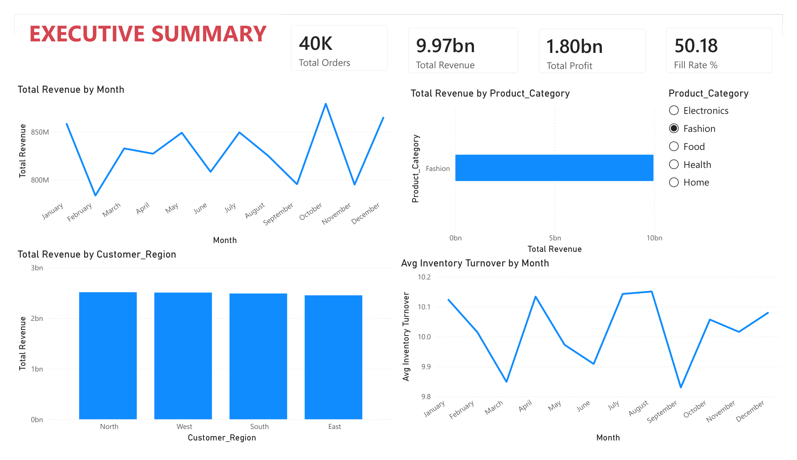
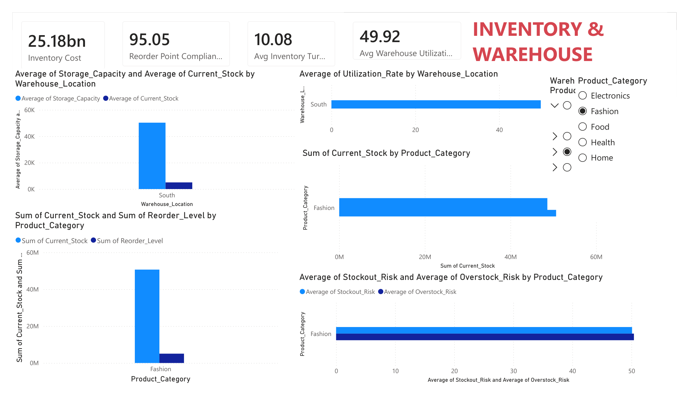
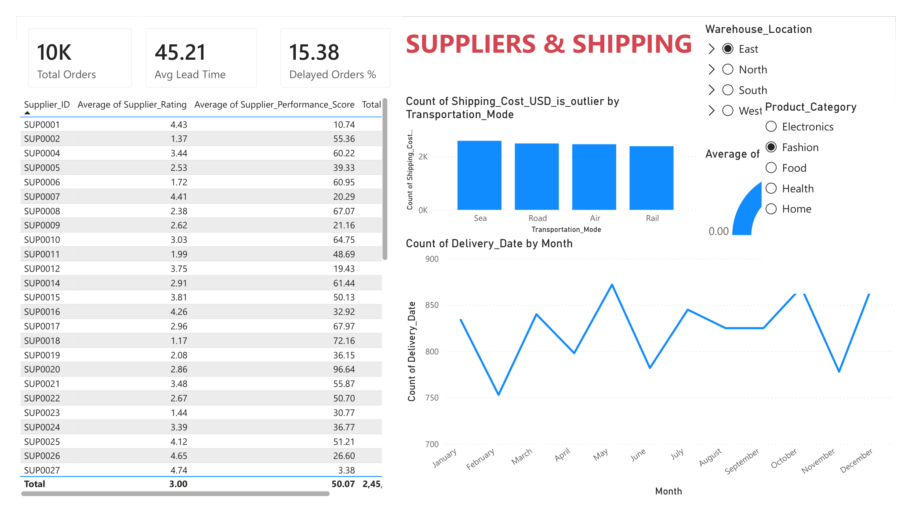
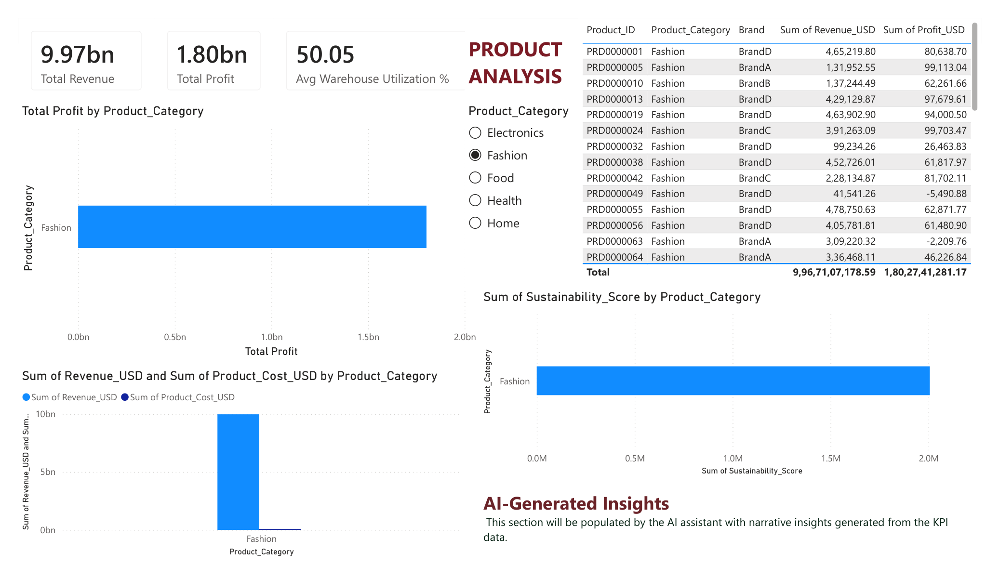
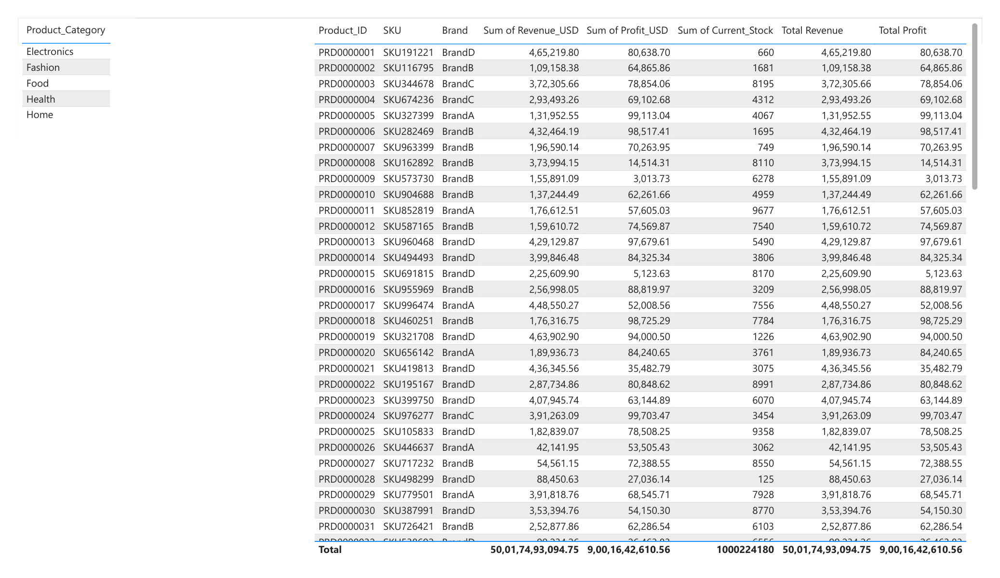

# AI-Assisted Supply Chain Optimization Dashboard

An end-to-end analytics project simulating a retail/logistics supply chain analytics function: SQL-based data modeling, Python data cleaning and EDA, a multi-page Power BI executive dashboard, and an AI assistant that turns calculated KPIs into plain-English business recommendations.

Built as a portfolio project demonstrating the skill set of a Data Analyst / BI Analyst / Business Analyst / AI Analyst.

## Dashboard Preview

**Executive Summary**


**Inventory & Warehouse**


**Supplier & Shipping**


**Product Analysis**


**Category Drillthrough**


The Power BI template (`powerbi/supply_chain_dashboard.pbit`) and a full PDF export (`dashboard/dashboard_export.pdf`) are included in this repo. The `.pbit` has no cached data — open it in Power BI Desktop and point it at your own `data/processed/cleaned_supply_chain.csv` (or MySQL instance) to reload it.

## Tech Stack

- **Python** (Pandas, NumPy) — data cleaning, feature engineering, EDA
- **SQL** (MySQL) — data modeling, KPI queries, window functions, CTEs
- **Power BI** — executive dashboard (DAX, Power Query, drill-through, bookmarks)
- **OpenAI API** — AI supply chain assistant (Q&A, root-cause analysis, recommendations)
- **Git & GitHub** — version control and portfolio hosting

## Project Structure

```
├── data/
│   ├── raw/            # original source data
│   └── processed/      # cleaned/engineered data
├── sql/                # schema + analysis queries
├── python/             # cleaning, EDA, KPI scripts
├── powerbi/             # .pbix file(s)
├── ai/                  # AI assistant scripts/prompts
├── docs/                # business problem, data dictionary, documentation
├── images/               # dashboard screenshots
└── dashboard/            # exported dashboard assets
```

## Build Progress

This project is built incrementally, phase by phase:

- [x] Phase 1 — Project Planning
- [x] Phase 2 — Dataset Understanding
- [x] Phase 3 — Data Cleaning
- [x] Phase 4 — SQL Database Creation
- [x] Phase 5 — SQL Analysis
- [x] Phase 6 — Python EDA
- [x] Phase 7 — KPI Calculation
- [x] Phase 8 — Power BI Dashboard
- [ ] Phase 9 — AI Assistant
- [ ] Phase 10 — Documentation
- [ ] Phase 11 — GitHub Deployment

See `docs/business_problem.md` for the business context and `docs/dataset_selection.md` / `docs/data_dictionary.md` for dataset details.
